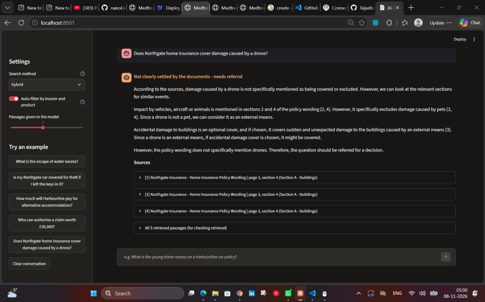
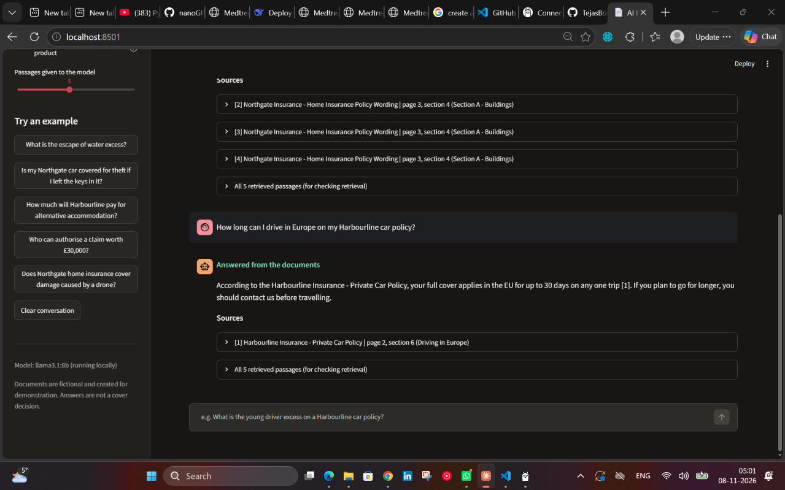
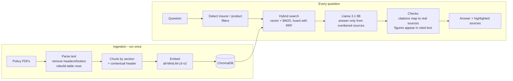

# AI Document Assistant for Insurance Policies

A retrieval-augmented generation (RAG) system that answers questions about insurance policy documents and shows exactly where each answer came from, down to the highlighted passage on the original PDF page.

Built as a practical example of how an insurer could let claims handlers and service staff query policy wordings in plain English, without the model making up cover terms.





## What it does

- Answers questions like *"My washing machine leaked, what's my Harbourline excess?"* in plain English
- Cites the insurer, document, page and section for every fact
- Shows the original PDF page with the cited passage highlighted
- Says when the documents don't answer the question, and recommends referral for grey areas instead of deciding cover itself
- Flags any answer containing a figure that isn't in its cited sources
- Runs fully locally: documents and questions never leave the machine

## Results

Evaluated end to end on 29 questions across seven categories (lookups, insurer traps, conditions, procedures, internal staff questions, a calculation, and questions with no answer in the documents).

| Metric | Result |
|---|---|
| Correct answers (answerable questions) | 27 / 27 |
| Cited the right document | 26 / 27 |
| Cited the right section | 25 / 27 |
| Refused or referred when the documents had no answer | 2 / 2 |
| No unsupported figures | 27 / 29 |
| Average time per answer (laptop CPU) | 15 s |

The two figure flags were false positives: one figure came from the user's question (£30,000), and one was a correct calculation (£300 + £250 = £550) that isn't written in the document. Full answers are in [`reports/answer_evaluation.csv`](reports/answer_evaluation.csv).

The test set is small and was written alongside the documents, so these results show the system works on this set rather than on any question a user might ask. A larger set written by people who haven't seen the documents would be the next step.

## How it works



1. **Parsing** (`src/ingestion/pdf_parser.py`): extracts text with PyMuPDF, crops out page headers and footers by position, rebuilds table rows from cell coordinates so values stay next to their labels, and tracks section headings by font size.
2. **Chunking** (`src/ingestion/chunker.py`): splits within section boundaries only, breaks on line boundaries so table rows are never cut, overlaps neighbouring chunks, and prefixes every chunk with its insurer, product, document type and section.
3. **Embedding and storage** (`src/retrieval/`): embeds chunks locally and stores them in ChromaDB with metadata.
4. **Retrieval** (`src/retrieval/retriever.py`): combines vector search and BM25 keyword search using Reciprocal Rank Fusion, and filters by insurer or product when the question names one.
5. **Generation** (`src/generation/`): sends numbered, labelled sources to a local Llama 3.1 8B model with rules on citing, quoting figures exactly, separating insurers, and referring grey areas.
6. **Checks**: citations are mapped back to the retrieved chunks (invented source numbers are dropped), and every £ amount and percentage in the answer must appear in the cited text.

## Problems I hit and how I solved them

These were found by testing, not anticipated, and most of what I learned came from them.

**Table values separated from their labels.** Raw PDF extraction put "Cash and bank notes" and "£500" on different lines. If a chunk boundary fell between them, the figure lost its meaning. PyMuPDF's built-in table finder merged words on these documents, so I rebuilt rows from the horizontal position of each cell instead.

**Two insurers' tables looked identical to search.** Harbourline's excess table never mentions "Harbourline", so a question about Harbourline could retrieve Northgate's table. Adding a contextual header to each chunk (`Harbourline Insurance | Home | Policy Wording | Section 5`) fixed it.

**Vector search ranked a definition above the answer.** Asked for the escape of water *excess*, embeddings preferred the clause *defining* escape of water, because it was more about the topic. Adding BM25 keyword search, which rewards exact terms like "excess", and fusing the two rankings fixed it.

**A filter bug from natural phrasing.** "Are cars covered..." didn't trigger the motor filter because it looked for "car". Home insurance passages got into a car question. Filters now match plurals and use phrases ("home insurance") rather than single loose words ("home"), after "returning home" on a travel question triggered the home filter.

**The model invented a figure.** Asked about cars in floods, the model stated a £5,000,000 limit that appears nowhere in the documents. The prompt already told it to quote figures exactly. The fix was a check in code, outside the model: any figure not found in the cited sources turns the answer red.

**Too strict, then too loose.** The first prompt refused a valid question because the answer was a rule ("15% of the sum insured or £50,000, whichever is lower") rather than a single figure. Loosening it made the model decide cover on a grey-area question about drones. The final prompt gives a third option: say the documents don't address it, cite the closest clause, and refer, which is how a claims handler would treat it.

## Tech stack

| Purpose | Tool |
|---|---|
| PDF generation (synthetic documents) | ReportLab |
| PDF parsing and page rendering | PyMuPDF |
| Embeddings | sentence-transformers, `all-MiniLM-L6-v2` |
| Vector database | ChromaDB |
| Keyword search | rank-bm25 |
| Language model | Llama 3.1 8B via Ollama (local) |
| Interface | Streamlit |

## The documents

The repo uses eight synthetic documents for two fictional insurers, Northgate Insurance and Harbourline Insurance: home and motor policy wordings, product information documents (IPIDs), a travel policy, and an internal claims handling procedure.

They are modelled on the structure of real UK policy documents but every word and figure is invented. Real policy wordings are copyrighted and company documents are confidential, so neither belongs in a public repo. Writing the documents also gave a known correct answer for every test question. The two insurers deliberately cover the same topics with different limits, to test whether the system cites the right one.

## Running it

Requires Python 3.12+ and [Ollama](https://ollama.com). Tested on Windows with 16 GB RAM and no GPU.

```bash
git clone https://github.com/TejasBornare97/insurance-rag-assistant.git
cd insurance-rag-assistant
python -m venv .venv
.venv\Scripts\activate            # Windows
# source .venv/bin/activate       # macOS / Linux
pip install -r requirements.txt
ollama pull llama3.1:8b
```

Build the pipeline (the PDFs are already in the repo; regenerate them with `python -m scripts.generate_documents` if you change the content):

```bash
python -m src.ingestion.pdf_parser     # PDFs -> parsed sections
python -m src.ingestion.chunker        # sections -> chunks
python -m src.retrieval.vector_store   # chunks -> embeddings in ChromaDB
```

Ask questions:

```bash
streamlit run app/streamlit_app.py
# or from the command line
python -m src.generation.answer "What is the Harbourline escape of water excess?"
```

Evaluate:

```bash
python -m scripts.evaluate_retrieval   # retrieval only: Hit@1, Hit@5, MRR
python -m scripts.evaluate_answers     # full system, ~10 minutes
```

## Project structure

```
app/                    Streamlit interface
data/
  documents/            synthetic policy PDFs
  manifest.json         document metadata
  answer_key.json       29 test questions with known answers
reports/                evaluation output
scripts/
  policy_content.py     text of the synthetic documents
  generate_documents.py builds the PDFs
  explore_embeddings.py hands-on look at embeddings
  evaluate_retrieval.py retrieval metrics
  evaluate_answers.py   end-to-end answer evaluation
src/
  config.py             all settings in one place
  ingestion/            parsing and chunking
  retrieval/            embeddings, vector store, hybrid retrieval
  generation/           prompt, model call, citation and figure checks
```

## Limitations and next steps

- **Small, self-written test set.** The next step is questions from people who haven't seen the documents.
- **Calculations are flagged.** The figure check can't tell a correct sum from an invented number. Having the model show its working, or checking arithmetic separately, would fix this.
- **Speed.** 15 seconds per answer on a laptop CPU. A GPU or a hosted model would bring this to a second or two; the model call is isolated in `src/generation/llm.py` so switching is a one-file change.
- **Document versions.** Real insurers have several versions of a wording in force at once. Filtering by effective date and the customer's policy start date would be needed.
- **Scanned PDFs.** The parser expects text-based PDFs; scanned documents would need OCR first.
- **Access control.** Internal procedures should only be searchable by staff, which would need filtering by user role.

## Disclaimer

All documents are fictional and created for demonstration. Nothing here is a real insurance product, and answers are not cover decisions.
